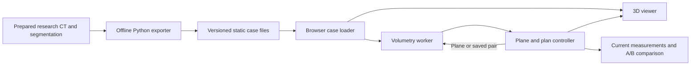

# HepatoPlan backend design

This design covers case preparation, static assets, case loading, volumetry, and the state needed to save and compare plans. The core MVP covers BE-01 through BE-06 and the data contracts behind FE-01 and FE-03 through FE-06. The 3D A/B plan difference view adds FE-07 and BE-07 after the core demo passes. [Product requirements](HepatoPlan%20Product%20Requirements.md)

## Architecture decisions

| Decision | Rationale |
| --- | --- |
| Prepare research cases offline in Python and serve the outputs as versioned static assets. | The case set is curated for the demo. Offline preparation keeps NIfTI processing and mesh generation out of the browser and removes the need for a calculation server. |
| Store one cropped, lossless label volume and two display meshes per case. | A single byte per voxel preserves the original segmentation labels. Cropping removes background outside the anatomy, and keeping the meshes separate lets the viewer style the liver and tumour independently. |
| Use one millimetre coordinate system from preprocessing through rendering and calculation. | A plane must divide the displayed anatomy at the same location where the engine classifies the voxels. |
| Run a pure TypeScript volumetry engine in one Web Worker for the active case. | The worker keeps repeated voxel scans off the rendering thread. The engine can be tested with synthetic masks without a browser or viewer. |
| Keep plans in application memory, grouped by release and case. | Plan comparison is a demo-session feature. A saved plan can carry its full input and results without database storage. |
| Compare two saved planes using the active case worker and the existing liver mesh. | One scan of the prepared mask gives the four comparison volumes. The viewer can show where the saved cuts differ using the same case assets. |



## Offline case preparation

Use NiBabel, NumPy, scikit-image, and trimesh. Take an extracted Task03 Liver dataset directory, a local allowlist mapping public case IDs to source image stems, and a release ID. Read the matching labelled CT and segmentation files. Prepare 3–5 cases for the submission, with one valid case as the minimum for the end-to-end demo. Record the source dataset, attribution, licence, and the fact that the published assets were cropped and converted in the release documentation. The dataset publisher identifies the licence as CC BY-SA 4.0. [MSD dataset and licence](https://medicaldecathlon.com/) · [Official download](https://medicaldecathlon.com/dataaws/)

For each selected case:

1. Validate that the CT and label map are 3D and share shape and spatial alignment. Express both affines in millimetres before comparison. Reject an unreadable file, non-finite or singular affine, an unverified spatial unit, a misaligned pair, or labels outside `0`, `1`, and `2`. Both foreground labels must be present. If a header omits units, require a verified unit for that source in the local preparation config.
2. Crop the label map to the bounding box of labels `1` and `2`, retaining every labelled voxel. Keep the original voxel grid and labels. Record the crop origin during export and compose the source affine with the crop translation so that a voxel centre retains its original physical position.
3. Generate the liver envelope from the union of labels `1` and `2`, and the tumour mesh from label `2`. For each binary surface, pad the crop by one background voxel on all sides and run marching cubes at level `0.5` with unit spacing. Subtract the padding offset from the vertices, then apply the crop affine once. Preserve outward face winding when the affine reverses handedness. The original parenchyma label alone supplies liver volumes. [scikit-image marching cubes](https://scikit-image.org/docs/stable/api/skimage.measure.html#skimage.measure.marching_cubes)
4. Write and validate the full case bundle before listing it in the public index. Check label counts against the source, re-read the mesh files, and verify alignment on a synthetic fixture and the prepared cases. Publish the release directory and index together. Use a new release ID when any bundled asset changes.

Keep the source CT, original NIfTI headers, and local case mapping outside the served directory. The public files use demo case IDs and the derived spatial metadata needed by the application.

## Static case contract and loading

```text
public/cases/
  index.json
  releases/<releaseId>/<caseId>/
    metadata.json
    labels.bin
    liver.stl
    tumour.stl
```

- `index.json` contains `schemaVersion: 1`, an immutable `releaseId`, and `cases` with a unique `caseId` for each published case. Use lowercase letters, digits, and hyphens for identifiers. Derive file URLs from the index URL so hosting under a subpath works.
- `metadata.json` contains `schemaVersion`, `releaseId`, `caseId`, `dimensions` as `[nx, ny, nz]`, `voxelSpacingMm` as three affine-column lengths, `voxelToWorldMm` as a row-major 4×4 matrix, and `labelCounts` with `parenchyma` and `tumour` counts. The affine is authoritative for positions and volumes.
- `labels.bin` is a headerless `uint8` array of exactly `nx * ny * nz` bytes in NumPy C order. Voxel `(i, j, k)` is at `(i * ny + j) * nz + k`, with `k` varying fastest. Labels are `0` background, `1` liver parenchyma, and `2` tumour.
- The two binary STL files store display vertices in the same physical frame as the masks. Treat their coordinates as millimetres. Render both meshes in that frame and set the camera target from the liver mesh bounds. Keep rendering transforms and the calculation plane aligned.

Load the index on entry. For a selected case, validate its metadata and fetch the three binary assets in parallel. Check schema versions, IDs, finite spatial fields, valid dimensions, mask byte length, and decodable finite mesh geometry. The worker validates the mask labels and checks the metadata counts during initialisation. Make the case available only after both meshes and worker initialisation succeed.

Abort the previous load on selection change, terminate its worker, and release the previous meshes. Guard asynchronous completions with a selection token so an old load cannot install assets or publish results. A missing or invalid asset leaves the requested case unavailable and offers retry or a different case. Keep the index revalidatable and serve assets under their immutable release paths.

## Plane and calculation contract

The viewer and engine share the selected NIfTI reference frame in RAS+ millimetres. An integer voxel index denotes its centre. If the crop affine has linear part `A` and translation `t`, then `X = A · [i, j, k] + t` gives the physical point. [NiBabel coordinate systems and affines](https://nipy.org/nibabel/coordinate_systems.html)

```ts
type Vec3 = readonly [number, number, number]

type ResectionPlane = {
  pointMm: Vec3
  unitNormal: Vec3
  resectSide: 'positive' | 'negative'
}

type VolumetryResult = {
  totalParenchymaMl: number
  resectedMl: number
  remainingMl: number
  flrPercent: number
  resectedPercent: number
  tumourIntersectsPlane: boolean
  tumourPlaneDistanceMm: number
}
```

### Plane behaviour

- Validate finite inputs and normalise the normal before applying a change. A zero-length or non-finite normal leaves the preceding valid plane active.
- The initial and reset plane passes through the centre of the liver mesh bounds, points along world `+X`, and uses the positive side for removal. Flipping the removal side keeps the plane position and normal.
- The plane controller maps the two sliders to the same `ResectionPlane` used by the viewer and worker. If `C` is the centre of the liver bounds, `offsetMm` is the signed displacement along world X and `theta` is the signed angle about world Z, the point is `P = C + [offsetMm, 0, 0]` and the unit normal is `N = [cos(theta), sin(theta), 0]`. Convert degrees to radians before evaluating the trigonometric functions. Use a symmetric offset range of ± the liver's X half-width rounded up to a whole millimetre, with 1 mm steps. Use −45° to +45° with 1° steps for angle.
- Provide three starting presets: **Negative offset** at −60% of the offset limit and −10°, **Centre tilt** at 0 mm and +8°, and **Positive offset** at +60% of the offset limit and +14°. Round preset offsets to the nearest slider step. Apply both values in one plane revision while retaining the selected removal side. When opening a saved plan, restore the slider readouts from `P.x - C.x` and `atan2(N.y, N.x)` converted to degrees.
- With point `P` and unit normal `N`, signed distance is `d = N · (X - P)`. Positive-side removal uses `d > 0`, and negative-side removal uses `d < 0`. A parenchyma voxel centred exactly on the plane is counted as remaining in either configuration.
- For rendering, create two display materials with opposite clipping planes derived from the same `P` and `N`. Map removal and remaining colours to the selected side. Three.js clips negative signed distances, so the material assigned to the positive side uses `N` and constant `-N · P`. Keep the tumour visible independently of the liver clipping. [Three.js material clipping](https://threejs.org/docs/pages/Material.html#clippingPlanes)
- Keep overlay visibility and liver opacity in viewer state. Show the translucent plane overlay by default. Apply liver opacity to both clipped materials. Toggling the overlay only hides or shows the plane graphic and leaves the two clipped regions visible. Only changes to plane geometry or removal side create a measurement revision.

### Parenchyma and tumour calculations

1. Compute `voxelVolumeMm3 = abs(det(A))` and count label `1` voxels once per case. At each plane revision, count label `1` voxel centres on the selected removal side. Derive the remaining count by subtraction and convert counts to volumes with `count * voxelVolumeMm3 / 1000`. Calculate both percentages against the total label `1` count. The UI rounds results for display and plan comparison retains full precision.
2. For label `2`, give each voxel its full physical extent. For affine columns `a0`, `a1`, and `a2`, compute the projected half-width `h = 0.5 * (abs(N · a0) + abs(N · a1) + abs(N · a2))`. A tumour voxel intersects the plane when its centre's `abs(d) <= h`, including a touch at the boundary. The closest distance for that voxel is `max(0, abs(d) - h)`. Use the minimum over tumour voxels, so disconnected tumour regions on opposite sides do not imply an intersection when the plane passes through a gap. Present the result as estimated geometry for research and education.
3. Project the affine onto the plane normal once per calculation. Evaluate signed distances as `N · (t - P) + (N · a0) * i + (N · a1) * j + (N · a2) * k` while scanning the crop. This avoids allocating physical-coordinate arrays or transforming a vector object for every voxel.

## Worker and session behaviour

- **Initialise.** Transfer the mask buffer to a dedicated worker once per case. The worker validates it and caches its dimensions, affine, and label counts. The pure engine receives the prepared mask and a valid plane. React and Three.js depend only on the controller and result contract.
- **Evaluate.** Each accepted plane change increments a revision and updates the viewer immediately. Post `evaluate` with the selection token, revision, and plane. Return a result or calculation error with the same token and revision. Allow one evaluation in flight and retain only the newest pending revision. Schedule pending work at most once per animation frame.
- **Publish.** Display and save results only when the token and revision match the active case and plane. Show an updating state while current measurements are pending. On an active calculation error, show measurements as unavailable and offer retry. Recreate and reload the worker after a worker crash.
- **Save and compare.** A saved plan snapshots its ID, name, release and case IDs, plane, and full-precision result. It can also store procedure type, reason, and notes. Name is required at save time, and the result must match the current revision. Opening a plan restores its plane and evaluates it through the same path. Compare saved snapshots from the same release and case. Plans stay available when switching cases during the session.

## 3D A/B plan difference view

Add **Show Differences** to the existing saved-plan comparison. A valid pair contains two distinct saved plan IDs from the active case and release. Their order determines which plan is A and which is B. Both the 3D view and voxel calculation take their planes from these snapshots. The side-by-side table continues to use the saved single-plan results.

### Pairwise volumetry

Expose a pure `comparePlans(preparedCase, planeA, planeB)` calculation. Precompute the affine projection for each plane and apply the same centre classification as single-plan volumetry. Each projection uses the plan's own removal side. A centre on a plane counts as retained for that plan.

Scan the prepared mask once, counting only label `1`. Route each voxel to one of four counters from the two removal decisions. Convert each count to full-precision millilitres with the cached `voxelVolumeMm3 / 1000`. Return the four fields as `PlanDifferenceResult`.

| Removed by A | Removed by B | Result field |
| --- | --- | --- |
| Yes | No | `removedOnlyByAMl` |
| No | Yes | `removedOnlyByBMl` |
| Yes | Yes | `removedByBothMl` |
| No | No | `retainedByBothMl` |

The four counts sum to the case's parenchyma count. A's removed volume is `removedOnlyByAMl + removedByBothMl` and A's retained volume is `removedOnlyByBMl + retainedByBothMl`. Swap A and B for the corresponding B totals. Round when displaying the four labels, using the results panel's existing volume formatting.

### Worker requests and state

- When a valid ordered pair is first selected or changes, send a `comparePlans` request to the active case's worker with both planes, the selection token, a new comparison request ID, and the ordered plan IDs. The worker uses its existing prepared case and echoes the identifiers on success or error.
- Share the worker's single in-flight slot with single-plane evaluations. Keep the latest pending comparison and latest pending plane evaluation. After the current job finishes, dispatch the pending plane evaluation first if there is one. A case switch terminates the worker and clears its queued work.
- Validate the pair against the active case and release. Clear the previous comparison volumes immediately when the selected pair or case changes. Apply a result or error only if the selection token, comparison request ID, and ordered plan IDs still match. Show an updating state for the current request and a retry action for a current failure. A retry uses the same pair with a new request ID. After a worker crash, reload the worker through the existing recovery path before retrying.
- The **Show Differences** toggle changes the viewer mode and reuses the current pair's pending or ready state. Camera movement, opacity changes, and re-rendering use existing comparison data. The pair and its results are session state.

### Viewer and legend

- Reuse the existing rotatable liver mesh in physical coordinates. Use a single comparison material that evaluates both signed plane distances at each surface fragment and selects one colour based on the same four cases as the worker. Give each exclusive region a distinct highlight and each shared region a muted colour. Classify zero signed distance as retained for each plane so a point receives one colour even on a shared boundary.
- Keep the existing WebGL lighting and opacity by extending a Three.js standard material with `onBeforeCompile`. Pass the two signed world-space plane equations and the four colours as uniforms. Refresh the plane uniforms when the selected pair changes. Switch between the current-plan material and the comparison material when the user toggles the view. [Three.js material customisation](https://threejs.org/docs/pages/Material.html#onBeforeCompile)
- Use the same labels and colours for the four legend entries. Render the surface colours from the selected pair immediately and show a loading state in the legend until its voxel result arrives. When the selection is incomplete, use the current-plan material and clear the comparison legend. Describe the colour map as a geometric view of the liver surface and the numbers as volumes from the underlying segmentation.

## Validation and implementation order

| Stage | Deliverable and verification |
| --- | --- |
| 1. Synthetic fixture and exporter | Export a small fixture with known labels, anisotropic spacing, and a rotated or reflected affine. Verify byte order, label counts, mesh positions, and crop invariance. Exercise mismatched CT and label affines, missing labels, and a truncated asset. |
| 2. Pure calculation engine | Test a known-volume cube, equal and unequal cuts, a plane outside the liver, a voxel centre on the plane, removal-side flips, and a voxelised sphere. Compare sphere values with the fixture's discrete ground truth and check approximation to the analytic volume within a fixture-defined voxelisation tolerance. Test anisotropic, reflected, and sheared affines. Verify label `2` exclusion and volume reconciliation. Test tumour contact at a voxel face, measured separation, and a cut through a gap between tumour regions. |
| 3. Loader, worker, and plan controller | Exercise retry, malformed metadata, rapid case changes, rapid plane moves, a failed worker response, and saving only current results. Verify that each preset changes both sliders and posts one plane revision, saved plans restore both readouts, and visibility and opacity changes post no revisions. Verify comparisons stay isolated by case. |
| 4. Prepared case and demo | Run the full workflow with one prepared case, then verify each additional published case. On the demo device, measure case load, worker evaluation time, and time from the final plane input to matching results. Use 150 ms at the 95th percentile after the case is loaded as the initial target for that last measurement. If it misses, profile mask scanning and mesh rendering separately before changing asset encoding or calculation strategy. |
| 5. A/B difference view | After the core demo passes, verify identical, complementary, and intersecting cuts on a synthetic case. Check on-plane ties, independent removal sides, label `2` exclusion, reconciliation with both single-plan results, and swapping A and B. In the browser, confirm that complementary cuts with equal FLR highlight opposite halves, the legend matches the view, and late results and errors are discarded after a pair or case change. |
